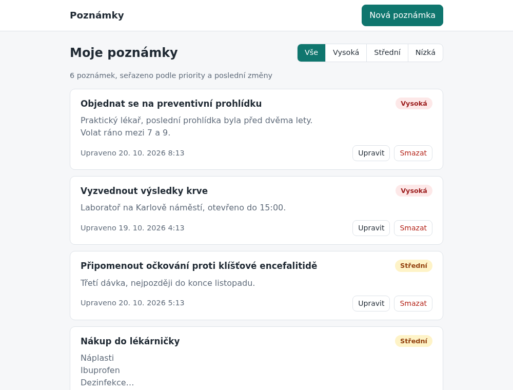

# Poznámky

## Co to je

Jednoduchá aplikace na správu poznámek s názvem, obsahem a prioritou (nízká, střední, vysoká). Poznámky lze vytvářet, upravovat a filtrovat podle priority; mazání je navíc nad rámec zadání. Backend je REST API v PHP a Symfony nad MariaDB, frontend je ve Vue 3 a celá aplikace se spouští jedním příkazem přes Docker Compose.



| Část | Technologie | Verze |
| --- | --- | --- |
| Backend | PHP, Symfony (LTS), Doctrine ORM a Migrations | PHP 8.5, Symfony 7.4 |
| Databáze | MariaDB (LTS) | 12.3 |
| Frontend | Vue 3, TypeScript, Vite, Vue Router | Node 24 LTS jen pro build |
| Infrastruktura | Docker Compose, nginx, PHP-FPM | nginx 1.30 |
| Kvalita | PHPUnit, PHPStan (level max), PHP-CS-Fixer, ESLint, vue-tsc, GitHub Actions | |

## Jak spustit

Potřebujete jen Docker s Compose v2.

```bash
docker compose up
```

První build trvá pár minut. Potom:

- **UI:** http://localhost:8080
- **API:** http://localhost:8080/api/notes

Při startu se spustí migrace a do prázdné databáze se nahraje šest ukázkových poznámek. Pokud je port 8080 obsazený, použijte jiný: `APP_PORT=8081 docker compose up`.

Užitečné příkazy:

```bash
docker compose up --build                     # po změně kódu (obrazy se sestaví znovu)
docker compose down -v                        # zastavit a smazat databázi (příště se nahrají demo data)

docker compose exec php composer test         # PHPUnit: funkční testy API proti testovací DB
docker compose exec php composer check        # CS-Fixer, PHPStan a testy, stejně jako backendový job v CI
docker compose exec php bin/console app:load-demo-data   # demo data ručně (jen do prázdné DB)
```

Kontroly frontendu mimo Docker (vyžadují Node 24):

```bash
cd frontend
npm ci
npm run lint          # ESLint
npm run type-check    # vue-tsc
npm run build         # typová kontrola a produkční build
npm run dev           # vývojový server na http://localhost:5173, /api posílá na běžící Docker stack
```

## Přehled API

Odpovědi s tělem jsou v JSON. Tělo požadavku musí mít `Content-Type: application/json`.

| Metoda | Adresa | Popis | Úspěch |
| --- | --- | --- | --- |
| `GET` | `/api/notes` | Seznam poznámek, seřazený podle priority a poslední změny | 200 |
| `GET` | `/api/notes?priority=high` | Seznam filtrovaný podle priority (`low`, `medium`, `high`) | 200 |
| `GET` | `/api/notes/{id}` | Detail poznámky | 200 |
| `POST` | `/api/notes` | Vytvoření poznámky | 201 + hlavička `Location` |
| `PUT` | `/api/notes/{id}` | Úprava poznámky (nahradí celý obsah) | 200 |
| `DELETE` | `/api/notes/{id}` | Smazání poznámky (nad rámec zadání) | 204 bez těla |

Pole v těle požadavku:

| Pole | Povinné | Pravidla |
| --- | --- | --- |
| `title` | ano | text, po oříznutí mezer neprázdný, nejvýše 200 znaků |
| `content` | ne | text, nejvýše 10 000 znaků, výchozí hodnota `""` |
| `priority` | ano | `low`, `medium` nebo `high` |

Příklad vytvoření (příklady používají `jq` pro čitelný výstup):

```bash
curl -s -X POST http://localhost:8080/api/notes \
  -H 'Content-Type: application/json' \
  -d '{"title": "Objednat se k zubaři", "content": "Ideálně dopoledne.", "priority": "high"}' | jq
```

```json
{
  "id": 7,
  "title": "Objednat se k zubaři",
  "content": "Ideálně dopoledne.",
  "priority": "high",
  "createdAt": "2026-10-19T10:15:54+00:00",
  "updatedAt": "2026-10-19T10:15:54+00:00"
}
```

Seznam vrací poznámky v obálce `{"data": [...]}`, aby šlo později přidat stránkování bez změny tvaru odpovědi.

### Chyby

Každá chyba pod `/api` má stejný tvar, včetně chyb, které vrací nginx (příliš velký požadavek, nedostupné PHP). Pole `fields` je jen u chyb validace a frontend ho přímo napojí na formulář.

```bash
curl -s -X POST http://localhost:8080/api/notes \
  -H 'Content-Type: application/json' \
  -d '{"title": "   ", "priority": "urgent"}' | jq
```

```json
{
  "error": {
    "code": "validation_failed",
    "message": "Zkontrolujte zadané údaje.",
    "fields": {
      "title": ["Vyplňte název."],
      "priority": ["Neplatná priorita. Povolené hodnoty: \"low\", \"medium\", \"high\"."]
    }
  }
}
```

| Stav | `code` | Kdy |
| --- | --- | --- |
| 400 | `invalid_json` | Tělo není platný JSON nebo chybí |
| 400 | `validation_failed` | Neplatná hodnota filtru `?priority=` |
| 404 | `not_found` | Poznámka neexistuje (i pro nečíselné id) |
| 405 | `method_not_allowed` | Nepodporovaná metoda, např. `PATCH`; hlavička `Allow` uvádí povolené |
| 413 | `payload_too_large` | Tělo je větší než 1 MB |
| 415 | `unsupported_media_type` | Tělo není JSON (chybí `Content-Type: application/json`) |
| 422 | `validation_failed` | Neplatná pole v těle, detail v `fields` |
| 500 | `internal_error` | Neočekávaná chyba; podrobnosti jsou jen v logu (`docker compose logs php`) |
| 503 | `service_unavailable` | PHP neběží nebo ještě startuje |

## Klíčové designové volby

**Symfony 7.4 LTS a PHP 8.5.** Symfony je rozšířený PHP framework s LTS verzemi a odpovídá stacku týmu. Řada 7.4 má opravy chyb do 11/2028 a bezpečnostní opravy do 11/2029; novější 8.1 má podporu jen do 01/2027. PHP 8.5 je nejnovější stabilní verze, MariaDB 12.3 aktuální LTS.

**Vrstvy bez zbytečných abstrakcí.** Controller jen převede HTTP na DTO a zpět. Zápisy dělá `NoteService`. Pravidla poznámky samotné (ořez a délka názvu, kdy se mění `updatedAt`) hlídá entita. Čtení jde z controlleru rovnou do repozitáře, protože služba by volání jen přeposílala. Nejsou tu rozhraní pro jedinou implementaci ani vlastní vrstvy nad Doctrine.

**DTO a Symfony Validator.** `NoteInput` odděluje kontrakt API od entity, takže se API a schéma DB můžou měnit nezávisle. Do entity se dostanou jen data, která prošla validací; entita navíc odmítne neplatný stav i při použití mimo API. Tělo mapuje `#[MapRequestPayload]`, controller je proto krátký. Hlášky jsou česky přímo u pravidel, protože je UI ukazuje uživateli. Výstup určuje `NoteResponse`, ne serializace entity.

**PUT místo PATCH.** Formulář vždy posílá celou poznámku, a to přesně odpovídá PUT (nahrazení celého zdroje). Vytvoření i úprava sdílejí jedno DTO a stejnou validaci. PUT je idempotentní, opakované odeslání je bezpečné. PATCH by musel rozlišovat chybějící pole od `null`; smysl dává až pro dílčí změny, třeba rychlou změnu priority ze seznamu.

**Jednotný formát chyb.** Jeden listener převádí všechny výjimky pod `/api` na stejný JSON. 422 znamená neplatná pole v těle, 400 nečitelný požadavek nebo neplatný parametr v URL. Zvažoval jsem RFC 9457 (Problem Details). Vlastní tvar je pro frontend jednodušší, protože `fields` přímo odpovídá polím formuláře. Přechod na RFC 9457 by znamenal změnu listeneru a funkce `toApiError` na frontendu.

**Řazení: priorita, pak poslední změna.** Nahoře jsou nejdůležitější a naposledy upravené poznámky. Priorita je v DB jako text, abecední řazení by proto bylo špatně; repozitář řadí přes `CASE` sestavený z `Priority::sortRank()`. Při shodě rozhoduje `id`, takže pořadí je stabilní. U filtrovaného seznamu se `CASE` vynechá a řazení obslouží index `(priority, updated_at)` bez třídění v paměti (ověřeno přes `EXPLAIN`).

**Čas přes Clock.** Služba bere čas z `ClockInterface`, ne z `new DateTime()`. V testech je čas pevný, takže testy řazení jsou deterministické. V DB je vše v UTC, API vrací ISO 8601 s posunem a prohlížeč zobrazí místní čas.

**Docker.** Tři služby: `db` (MariaDB), `php` (PHP-FPM) a `web` (nginx). Nginx servíruje sestavený frontend a `/api` předává PHP, takže UI i API běží na jedné adrese a není potřeba CORS. Node je jen v build stupni. PHP obraz má cíl `dev` (s dev závislostmi kvůli testům) a `prod` (bez nich, s OPcache preloadem); CI sestavuje oba. Žádný kontejner aplikace neběží pod rootem. Migrace a demo data spouští entrypoint PHP kontejneru; při více instancích by migrace byly samostatný krok nasazení. Služby čekají na healthcheck svých závislostí. Úpravy MariaDB a nginx jsou okomentované přímo v `compose.yaml` a `docker/`.

**Testy.** Funkční testy volají API přes HTTP kernel proti skutečné MariaDB, ne proti SQLite, aby ověřily stejné SQL jako produkce. Každý test běží v transakci, která se na konci vrátí (DAMA DoctrineTestBundle), takže jsou rychlé a nezávislé. Pokrývají řazení, filtr, validaci, chyby, 404 a příkaz na demo data. PHPStan běží na nejvyšší úrovni s rozšířeními pro Symfony a Doctrine. CI spouští stejný Compose stack jako lokálně.

**Frontend.** Vue 3 s Composition API a TypeScriptem. Stav je lokální ve view, globální store (Pinia) by tu nic nepřinesl. Klient API je malý typovaný modul nad `fetch` a chyby převádí na `ApiError`. Filtr je v URL (`/?priority=high`), takže ho lze sdílet a přežije obnovení stránky. Závazná pravidla validace jsou jen na backendu; UI chyby zobrazí u polí a počítadlo znaků jen upozorní předem. Frontend nemá unit testy, UI jsem ověřoval ručním průchodem v Playwrightu (viz Další vývoj).

## Ošetřené okrajové případy

- **Prázdný název nebo jen mezery:** 422, název se před validací i uložením ořízne.
- **Příliš dlouhý text:** limity 200 a 10 000 znaků se počítají ve znacích, ne v bajtech; čeština i emoji se počítají správně (pokryto testem).
- **Chybějící priorita:** 422 „Vyberte prioritu.“ **Neplatná priorita:** 422 se seznamem povolených hodnot.
- **Špatný typ hodnoty**, např. `"title": 42`: 422 u daného pole.
- **Nevalidní nebo prázdné tělo:** 400 `invalid_json`. Formulářová data místo JSON: 415. Tělo nad 1 MB: 413.
- **Neznámá pole v těle** se ignorují, aby starší klient nepřestal fungovat po přidání pole.
- **Neexistující poznámka nebo nečíselné id:** 404 v JSON, i u `PUT` a `DELETE`.
- **Neplatný filtr** `?priority=urgent` nebo prázdný `?priority=`: API vrací 400, UI neplatnou hodnotu z URL odstraní.
- **Uložení beze změny:** neposune `updatedAt`, pořadí v seznamu se nezmění.
- **Rychlé přepínání filtru:** starší požadavek se zruší (`AbortController`), pomalejší odpověď nepřepíše novější.
- **Smazání během načítání seznamu:** seznam se po smazání načte znovu, starší odpověď tak smazanou poznámku nevrátí.
- **Smazání poznámky, kterou už smazal někdo jiný:** UI ji jen odebere ze seznamu, výsledek je stejný.
- **Úprava neexistující poznámky v UI:** stav „poznámka neexistuje“ s odkazem zpět.
- **Výpadek API nebo sítě:** chybový stav s tlačítkem „Zkusit znovu“. Neočekávané chyby UI neukazuje surově, zobrazí obecnou hlášku.
- **HTML v obsahu:** Vue text vždy escapuje a `v-html` se nepoužívá, XSS přes obsah poznámky proto není možné.
- **Dvojí odeslání formuláře:** tlačítko je během ukládání zablokované.
- **Opakovaný start kontejneru:** demo data se nahrají jen do prázdné databáze. Po smazání všech poznámek a restartu se vrátí; vypnout to lze přes `LOAD_DEMO_DATA: "0"` v `compose.yaml`.

## Další vývoj

- **Uživatelé a oprávnění.** Přihlášení (session nebo tokeny), sloupec `owner_id` a všechny dotazy omezené na vlastníka. Cizí poznámka by vracela 404, ne 403, aby nešlo zjistit, že existuje. To je první krok před nasazením pro více uživatelů.
- **Souběžné úpravy.** Teď vyhrává poslední uložení. Přidal bych verzi poznámky (Doctrine `#[ORM\Version]`), `ETag` v odpovědi a `If-Match` u `PUT`. Při konfliktu by API vrátilo 412 a UI nabídlo porovnání změn.
- **Stránkování a hledání.** Seznam teď vrací všechno. Při větším počtu poznámek bych přidal kurzorové stránkování (stabilní i při změnách) a fulltextové hledání v názvu a obsahu.
- **Archivace místo mazání.** Smazání je nevratné. Archiv nebo koš s obnovením, případně „Zpět“ hned po smazání, chrání před omylem.
- **Štítky.** Vazba M:N a filtr podle štítků. Priorita určuje pořadí, štítky dělí poznámky podle témat.
- **Markdown v obsahu.** Ukládat zdrojový text a vykreslovat ho na frontendu knihovnou, která HTML sanitizuje.
- **Rychlé akce.** Změna priority přímo ze seznamu přes `PATCH` (JSON Merge Patch) a upozornění na neuložené změny při odchodu z formuláře.
- **Dokumentace API.** OpenAPI generované z DTO (NelmioApiDocBundle), aby se dokumentace nerozcházela s kódem; z ní by šly generovat i typy pro frontend.
- **Testy frontendu.** Vitest pro klienta API a skládání formuláře, E2E testy UI (Playwright) v CI proti Compose stacku.
- **Provoz.** Migrace jako samostatný krok nasazení, secrets mimo repozitář, TLS k databázi, strukturované logy a monitoring.

## Struktura projektu

```
backend/
  src/Controller/NoteController.php            HTTP vrstva: mapuje požadavek na DTO a volá službu
  src/Dto/NoteInput.php                        vstup pro POST a PUT, pravidla validace
  src/Dto/NoteListQuery.php                    filtr seznamu (?priority=)
  src/Dto/NoteResponse.php                     tvar poznámky v API
  src/Service/NoteService.php                  zápisy: vytvoření, úprava, smazání
  src/Entity/Note.php                          entita a její pravidla (název, obsah, časy změn)
  src/Enum/Priority.php                        backed enum priority a její pořadí
  src/Repository/NoteRepository.php            dotaz na seznam s řazením a filtrem
  src/EventListener/ApiExceptionListener.php   jednotný JSON pro všechny chyby
  src/Command/LoadDemoDataCommand.php          demo data
  migrations/                                  Doctrine migrace
  tests/                                       funkční testy API a test příkazu
frontend/src/
  api/notes.ts                                 typovaný klient API a třída ApiError
  views/                                       seznam, vytvoření, úprava, 404
  components/                                  formulář, karta poznámky, filtr, štítek priority
  composables/useNoteSave.ts                   společné odeslání formuláře a zobrazení chyb
docker/                                        Dockerfile pro PHP a web, nginx, init SQL
compose.yaml
.github/workflows/ci.yml
```
